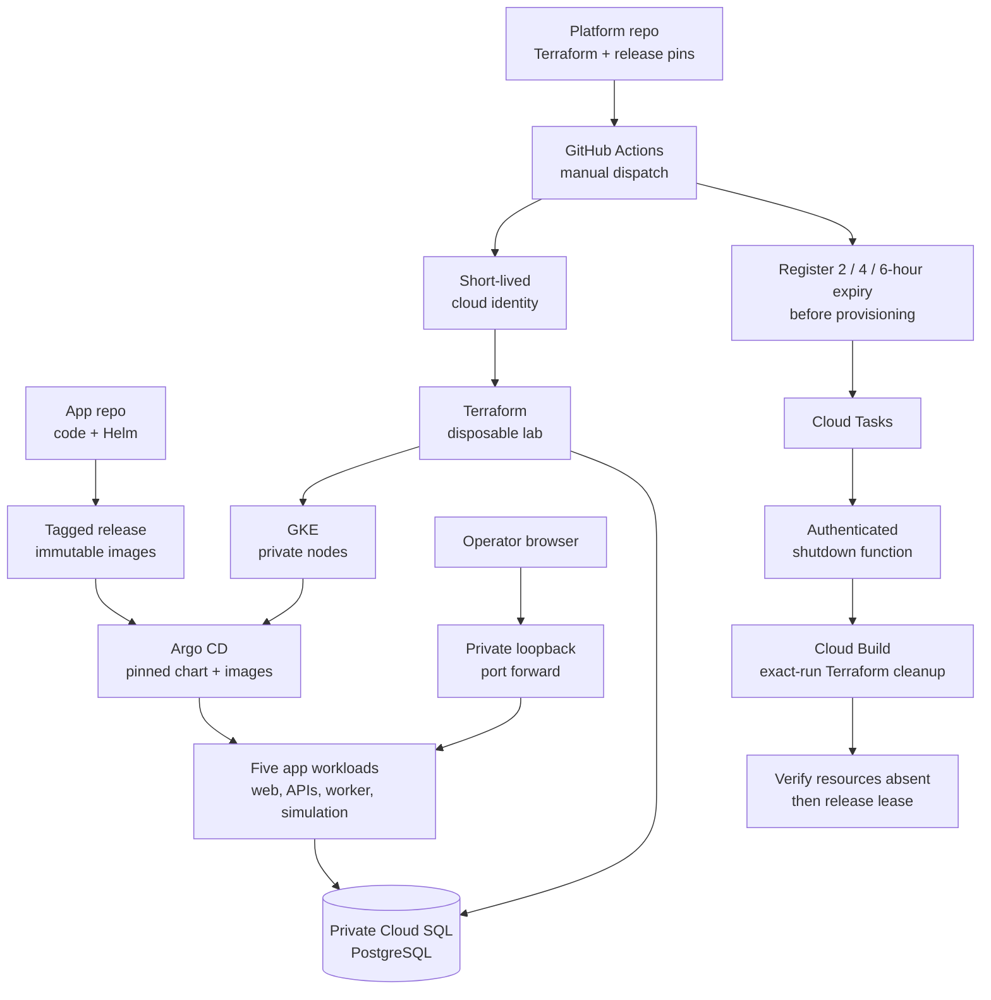

# Ottawa Fleet Platform

The platform team's repository for operating a small mock Ottawa fleet application. Learning goals: application delivery, Kubernetes, GitOps, scaling, service traffic, observability and eventually AI-assisted operations.

## Back after a week or two? Start here

We are building a small platform around a synthetic fleet app so we can learn
delivery, reliability, scaling and operations through visible experiments.
Start with the app's
[short guide and videos](https://github.com/ANISHG-26/ottawa-fleet-app/blob/main/QUICK_GUIDE.md),
then use this map to remember how it runs.

**Snapshot — October 20, 2026:** the app runs at **v0.2.1** in a disposable GKE
lab. A fresh workflow provisions the lab and automatically deploys the verified
stable release. Today's trip, reuse, refresh and Stop-and-drain checks passed.
See [the dated acceptance record](docs/acceptance/automatic-application-bootstrap.md).
This is a working learning environment; broader phase acceptance remains open.

## Architecture at a glance



**Read it in three passes:** GitHub starts the bounded environment; Argo deploys
the app and PostgreSQL keeps its state; the independent expiry path removes the
run's cloud resources even after the GitHub runner exits. A retained network and
automation foundation are separate from each disposable run. The active-run
lease prevents overlapping labs. Existing labs keep their pinned release;
new stable tags are selected on the next fresh dispatch.

**Starting a session:** Actions → **Bounded GCP lab** → **Run workflow** on
`main` → choose **2**, **4** or **6** hours. The default is 2. Time includes
provisioning, and cleanup starts at the fixed deadline; deletion can take longer.
Longer choices require the compatible shutdown function and its activation
setting first; see [session setup](docs/runbooks/on-demand-ci.md#session-duration-and-cleanup-activation).
This choice creates a new session; it does not extend an existing run.

## Current / next / later

| Where we are | What that means |
|---|---|
| Working now | Tagged images/chart, five app workloads, durable simulation, Argo deployment and automatic app bootstrap. [First deployment](docs/acceptance/first-application-deployment.md); [fresh automatic run](docs/acceptance/automatic-application-bootstrap.md). |
| Lifecycle evidence | The October 9 lab's scheduled cleanup completed. October 20's deadline remained fixed; its later cleanup was not yet observed in this snapshot. |
| Next experiments | Measure worker/backlog recovery ([#7](https://github.com/ANISHG-26/ottawa-fleet-platform/issues/7)), demonstrate drift correction and schema-compatible rollback ([#14](https://github.com/ANISHG-26/ottawa-fleet-platform/issues/14)). |
| Available separately | LGTM telemetry configuration and runbooks; a dedicated LGTM stack was not installed in the October 20 lab. Logs and basic metrics remain available. |
| Implemented, awaiting activation | Automatic LGTM installation and three-signal readiness for fresh labs ([#50](https://github.com/ANISHG-26/ottawa-fleet-platform/issues/50)); requires the app's trusted v0.2.2 or newer release, platform merge, and fresh-run acceptance. [Activation and UI access](docs/runbooks/on-demand-ci.md#automatic-lgtm-stage-and-access). |
| Later | KEDA backlog scaling, Istio traffic experiments, Backstage, read-only AI investigation, then separately reviewed remediation. |

Green/blue is currently a visual app marker, not blue-green traffic routing.
Read dated evidence as a snapshot, not a promise that a temporary lab is online.
Use the [board](https://github.com/users/ANISHG-26/projects/6) for the active queue.

To refresh this entry point as we grow, use the versioned
[project-learning-guides skill](skills/project-learning-guides/SKILL.md).
It keeps the root explanation short and sends implementation detail to runbooks.

## Two repositories, one program

| Logical team | Repository | Owns |
|---|---|---|
| Application | [ottawa-fleet-app](https://github.com/ANISHG-26/ottawa-fleet-app) | Go APIs/workers, UI, contracts, migrations, Dockerfiles, Compose, application Helm chart and releases |
| Platform | This repository | Cluster bootstrap, environment values/release pins, Argo CD, KEDA, Istio, Terraform, observability, runbooks and later Backstage/AI SRE |

Both use the [shared project board](https://github.com/users/ANISHG-26/projects/6). Teams are responsibility boundaries for a solo learning project, not claims of staffed organizational teams.

Phase 1 builds and validates the application locally. Kubernetes/GitOps follow in Phase 2; KEDA and Istio in Phase 3; Backstage and AI SRE in Phase 4. Inference hosting is a separate future project. Cloud access is not a prerequisite for local work.

## Start here

- [Architecture and ownership](docs/architecture.md)
- [Delivery workflow and ticket map](docs/project-management.md)
- [Application release contract](docs/application-release-contract.md)
- [Roadmap and exit criteria](docs/roadmap.md)
- [Current ADR](docs/adr/0002-two-repository-local-first-platform.md)
- [Lab lifecycle](docs/runbooks/lab-lifecycle.md)
- [Local workload acceptance](docs/runbooks/local-acceptance.md)
- [First application deployment acceptance](docs/acceptance/first-application-deployment.md)
- [On-demand CI lab and expiry](docs/runbooks/on-demand-ci.md)
- [Telemetry setup](docs/runbooks/telemetry.md)
- [Reviewer credential lifecycle](docs/runbooks/lab-credentials.md)
- [Tooling ownership and validation map](docs/tooling-map.md)
- [Future AI boundary](docs/ai-stack.md)
- [Contributing](CONTRIBUTING.md)

## Layout

```text
bootstrap/     # kind plans, Argo bootstrap and GCP review gateway
gitops/        # Argo AppProject and immutable promotion inputs
observability/ # Local Compose and bounded Kubernetes LGTM configuration
controllers/   # Boundaries for future KEDA, Istio and Backstage integrations
terraform/     # Disposable lab, retained network, automation and access roots
functions/     # Authenticated expiry dispatcher for exact CI run cleanup
skills/        # Reusable workflow for short guides, diagrams and recorded scenarios
tests/         # Offline platform contracts and provider-mocked bounds checks
scripts/       # Acceptance, promotion, bootstrap and CI/cleanup tooling
docs/          # Architecture, ADRs, ownership, experiments and runbooks
.github/       # Repository/runtime checks and main-only lab dispatch
```

Application source, Docker/Compose packaging and Helm templates live in the
application repository. Platform tooling and environment configuration live here.

## Validate locally

```sh
python scripts/check_repository.py
python -m unittest discover -s tests -v
```

The repository check validates required files, local Markdown links and JSON.
The offline suite checks acceptance, release pins, bootstrap, expiry and cleanup
contracts. Terraform tests need initialized providers and otherwise report an
explicit skip. See [validation entrypoints](docs/tooling-map.md#validation-entrypoints)
for the additional provider and runtime checks used by CI. Passing these checks
does not prove a live rollout or teardown. Keep private deliberations, account
identifiers and credentials outside both public checkouts.
